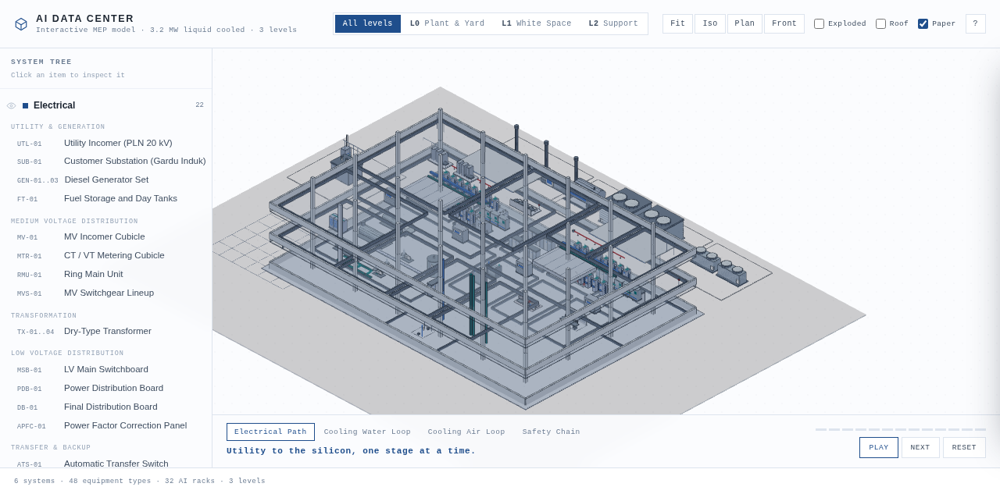
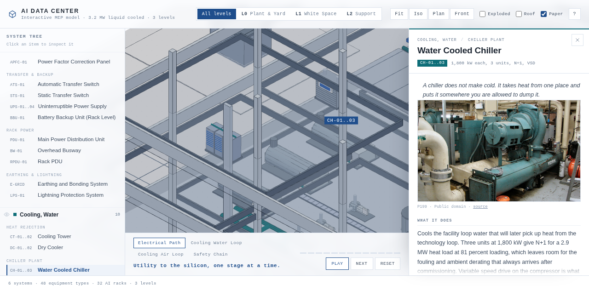

# AI Data Center — Interactive MEP Model

A three level, click through model of a **3.2 MW liquid cooled AI data center**, drawn as a working drawing rather than a render. Built to teach MEP from geometry and sequence instead of a wall of text.

**Live model:** https://romiradiansyah99.github.io/ai-dc-maket/



## What it is

| | |
|---|---|
| Scope | Utility to silicon, and heat rejection back out |
| Systems | 6 systems, 13 subsystems, 48 equipment types, 32 AI racks |
| Levels | L0 plant and yard, L1 white space, L2 support |
| Walkthroughs | Electrical path (13 stages), cooling water loop (8), air loop (4), safety chain (6) |
| Stack | Vanilla ES modules, three.js r160 vendored locally, no build step, no framework |

## What you can do with it

- **Read the hierarchy.** The left rail is a real MEP tree: system, then subsystem, then equipment. Clicking a row flies the camera to the object and opens its panel.
- **Isolate a level.** L0 is the plant and yard, L1 is the two data halls, L2 is support space. Exploded view separates the floors so the vertical risers become visible.
- **Follow a path.** The walkthrough maps the electrical chain from the 20 kV incomer to the rack, and the cooling chain from the cold plate back to the cooling tower, one stage at a time, with the camera following and a state badge at each node (20 kV, 400 V, 48 V DC, and so on).
- **Inspect equipment.** Every panel opens with a single sentence on what the thing actually does, then a photograph, then the engineering detail: function, design values, failure modes, commissioning checks and reference figures.
- **Navigate like SketchUp.** Drag to orbit, right drag to pan, scroll to zoom toward the cursor, `F` to fit. Touch gets one finger orbit and two finger pan and zoom.



## Design basis

The model is internally consistent, and the assumptions are stated so they can be argued with.

| Item | Value |
|---|---|
| IT load | 32 racks x 100 kW = 3,200 kW |
| Site load | 4,000 kW at PUE 1.25 |
| Site current | 6,078 A at 400 V, 0.95 pf |
| Redundancy | Electrical 2N, mechanical N+1 (Tier III intent) |
| White space | about 560 m2, roughly 175 m2/MW |
| Heat to water | 2,900 kW, with 300 kW left on air |

Sizing for every major piece of plant, with the loading margin shown, is in [docs/CAPACITY.md](docs/CAPACITY.md). No capacity in this model sits below its design load. If you change one of the three drivers (rack density, redundancy target, level split), that document is where the consequences show up.

## The drawing style

The pencil look is not a texture or a post process. Geometry is built from primitives, every mesh contributes an outline generated from `EdgesGeometry`, and each outline segment is displaced by a small deterministic noise so the lines read as drawn rather than computed. Primitives are merged per colour inside each equipment group, which keeps a 172 object site at a few hundred draw calls.

## Repository layout

```
index.html              shell and panels
assets/style.css        paper and pencil visual language
src/main.js             scene setup, level control, picking, camera flights
src/controls.js         orthographic navigation with zoom toward cursor
src/ui.js               system tree, equipment panel, walkthrough bar
src/scene/kit.js        primitive builder, geometry merging, pencil outlines
src/scene/build.js      building shell, risers, and every equipment builder
src/scene/flow.js       animated flow paths and travelling pulses
src/data/systems.js     the hierarchy: systems, subsystems, walkthroughs
src/data/equipment-*.js the equipment catalogue and its content
src/data/layout.js      site, levels, rooms, placements
docs/                   capacity ledger, architecture notes, photo credits
tools/fetch_photos.py   reference photo fetcher with licence capture
vendor/                 three.js r160, vendored so the site runs offline
```

## Adding equipment

1. Add an entry to one of the `src/data/equipment-*.js` files: tag, name, philosophy line, function, four design values, three failure modes, three commissioning checks, three reference figures.
2. Add the key to a subsystem in `src/data/systems.js`.
3. Add a builder in `src/scene/build.js`, or reuse an existing kind, and place it in `PLACE` with a level and coordinates.

The tree, the panels, the picking and the walkthroughs all read from those two files, so nothing else needs editing.

## Running locally

Any static server works, because there is no build step:

```bash
python3 -m http.server 8099
# open http://localhost:8099
```

WebGL required. three.js is vendored, so it also runs with no network access.

## Content standards

- Figures describe **this model**, not a vendor datasheet. Where a real project would differ, the panel says so.
- Every equipment panel opens with one sentence explaining what the equipment is really for. If the sentence is not true, the detail below it does not matter.
- Reference photographs come from Wikipedia and Wikimedia Commons under their own licences, with attribution in [docs/PHOTO-CREDITS.md](docs/PHOTO-CREDITS.md).
- "Learn more" links resolve to a curated video where one exists, and to a scoped YouTube search otherwise. Nothing links to a video ID that has not been checked.

## Limitations

- Geometry is schematic. It teaches arrangement and sequence, not dimensional coordination.
- No CFD, no thermal model, no control system simulation. The failure modes are described, not simulated.
- No project specific utility, permitting or code compliance content. Those belong to a real design.

## Licence

Code under MIT. Reference photographs keep their original licences, listed in [docs/PHOTO-CREDITS.md](docs/PHOTO-CREDITS.md).
