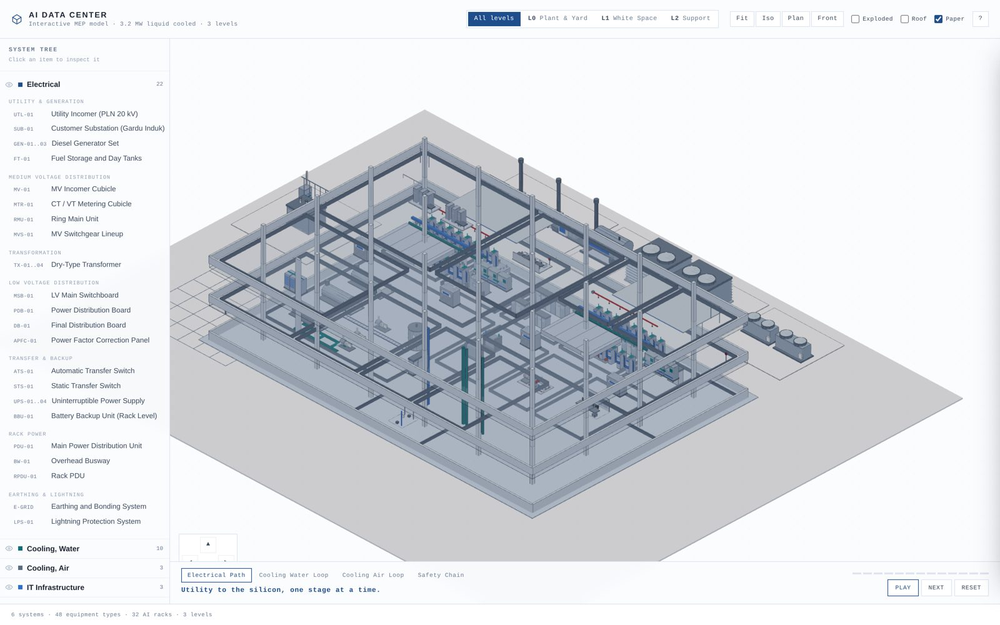
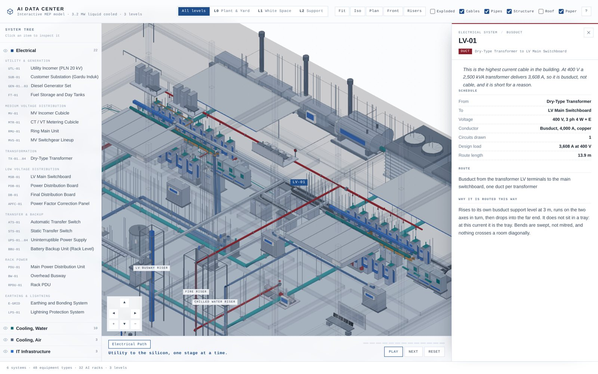
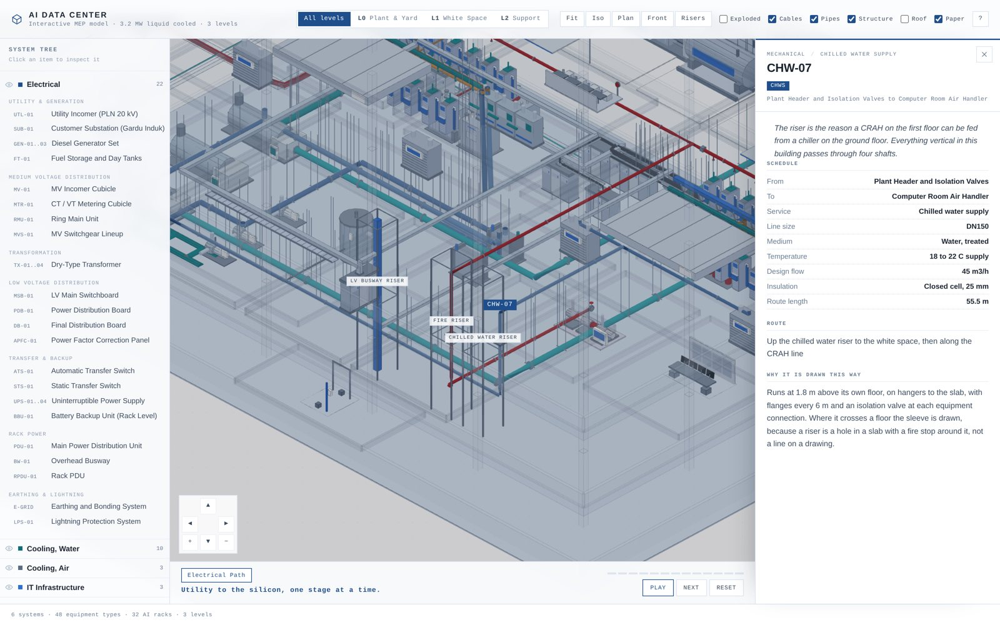
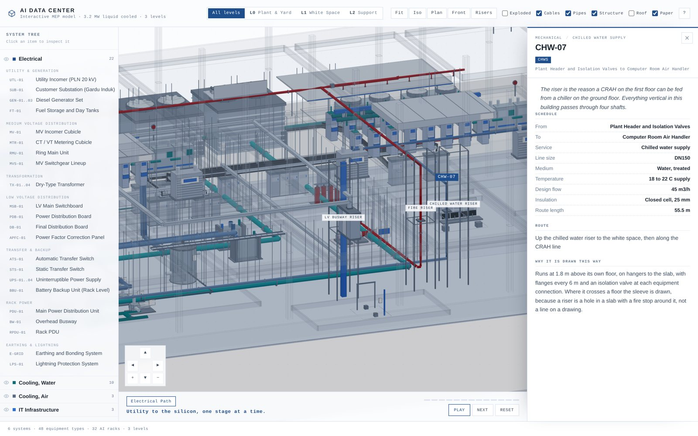

# AI Data Center — Interactive MEP Model

A three level, click through model of a **3.2 MW liquid cooled AI data center**, drawn as a working drawing rather than a render. Built to teach MEP from geometry and sequence instead of a wall of text.

**Live model:** https://romiradiansyah99.github.io/ai-dc-maket/



## What it is

| | |
|---|---|
| Scope | Utility to silicon, and heat rejection back out |
| Systems | 6 systems, 13 subsystems, 48 equipment types, 32 AI racks |
| Levels | L0 plant and yard, L1 white space, L2 support |
| Walkthrough | Electrical path, 13 stages, one stage at a time |
| Connections | 26 cables and busducts, 17 pipe runs, 4 riser shafts |
| Stack | Vanilla ES modules, three.js r160 vendored locally, no build step, no framework |

## What you can do with it

- **Read the hierarchy.** The left rail is a real MEP tree: system, then subsystem, then equipment. Clicking a row flies the camera to the object and opens its panel.
- **Isolate a level.** L0 is the plant and yard, L1 is the two data halls, L2 is support space. Exploded view separates the floors so the vertical risers become visible.
- **Follow the path, on the cable.** Two guided walkthroughs, and neither invents a route: each stage is bound to a specific circuit in the schedule, and the animation is built from that circuit's own polyline. The pulse runs inside the tray, climbs the riser, passes through the duct bank and drops into the far equipment, because that is the geometry it was given. Electrical path, 13 stages, 20 kV to 48 V DC. Cooling water loop, 9 stages, cold plate to tower.
- **Inspect equipment.** Every panel opens with a single sentence on what the thing actually does, then two visuals, then the engineering detail: function, design values, failure modes, commissioning checks and reference figures. The first visual is a model view rendered from that equipment's own geometry, so it always matches the object on screen. The second is a licensed reference photograph where one exists, with attribution.
- **See the connections, not just the boxes.** Every electrical circuit is modelled: 26 cables and busducts routed from the actual equipment positions, in ladder trays with rungs and hanger rods to the slab, or buried in a duct bank. Click any cable to read its schedule.
- **Navigate like SketchUp.** Left drag orbits. **Press and hold the scroll wheel and drag to pan**: no rotation, no zoom, just slide. Right drag and the arrow pad do the same, `Space` + drag also pans, the wheel zooms toward the cursor, `F` fits. Touch gets one finger orbit and two finger pan and zoom.
- **Find the risers.** The shafts are modelled with corner posts, a frame at every slab, penetration sleeves and a label. The **Risers** view jumps straight to them.



## The cable model

The connection layer is not decoration. Each circuit is a record in `src/data/cables.js` —
from, to, voltage, conductor, circuits, design load, route note, and why it is routed that
way — and `src/scene/cables.js` builds the geometry from those records against the real
equipment positions. The drawing and the schedule therefore cannot disagree.

| Group | Circuits | Drawn as |
|---|---|---|
| MV, 20 kV | Utility incomer, substation, incomer, metering, RMU, switchgear, 4 transformer feeders | 3 x 1C bundles, red, in tray or duct bank |
| LV, 400 V | 4 transformer busducts, APFC, PDB, DB, UPS, STS, generator output, ATS, riser to the white space | Busduct or multi-core bundles, dark, in tray |
| Rack power | PDU to busway, busway tap-offs to rack PDUs | Busduct and flexible drops |
| Earthing | Switchboard earth bar to site earth pit, building to substation ring | Single conductor, green/yellow, buried |

Routing follows installation practice: leave the equipment at the top face, rise into the
tray at the run elevation, run along one axis then the other, drop into the far end. Trays
carry rungs and hanger rods because a tray is supported, never floating. Busducts are drawn
as busducts, because at 4,000 A the tray *is* the busduct.

## Walkthroughs follow the connections

A walkthrough stage names a connection, not a pair of coordinates:

```js
{ k: 'pdumain', state: '400 V', link: 'LV-12', note: '...' }
```

`src/main.js` resolves that id against the cable or pipe layer, reverses it if the current
runs the other way, and hands the real polyline to `src/scene/flow.js`. That module fillets
the corners, resamples, and builds the tube and the travelling pulse from it.

Measured against the modelled geometry, the animated path never strays more than
**0.11 m** from the cable or pipe axis, on every stage of both walkthroughs, while the tube
itself is 0.17 m in radius. In other words it stays inside the cable it is describing. The
regression test is `tools/flow_dev.mjs`.

## The pipe model

Cooling and fire pipework is built the same way as the electrical layer: a schedule in
`src/data/pipes.js`, geometry generated from it in `src/scene/pipes.js`.

| Loop | Runs | Medium |
|---|---|---|
| Technology | Manifold to CDU, rack drops | 35% glycol, 45/38 C, DN200 and DN50 hoses |
| Facility, chilled water | CDU to heat exchanger, pump, header, chillers | Treated water, 32/26 C, DN250 |
| Condenser water | Chillers to cooling towers, dry cooler changeover | Treated water, 37/29 C, DN300 buried |
| CRAH | Header to the white space through the chilled water riser | 18 to 22 C, DN150 |
| Fire | Fire pump, riser, preaction pipe above both halls | Fire main, DN150, dry until two signals agree |

Every run is drawn with the thing that makes it read as pipework rather than a line:
insulation sleeve, flange pairs every 6 m, an isolation valve at each equipment connection,
hanger rods to the slab, and a sleeve wherever it passes a floor. Supply and return legs are
drawn as a pair, offset perpendicular to the run.

The four riser shafts (LV busway, chilled water, fire, fiber) are enclosed with corner posts
and a frame at every slab, so a vertical run reads as a shaft through a building rather than
a floating line.





## Design basis

The model is internally consistent, and the assumptions are stated so they can be argued with.

| Item | Value |
|---|---|
| IT load | 32 racks x 100 kW = 3,200 kW |
| Site load | 4,000 kW at PUE 1.25 |
| Site current | 6,078 A at 400 V, 0.95 pf |
| Redundancy | Electrical 2N, mechanical N+1 (Tier III intent) |
| White space | about 560 m2, roughly 175 m2/MW |
| Heat to water | 2,900 kW, with 300 kW left on air |

Sizing for every major piece of plant, with the loading margin shown, is in [docs/CAPACITY.md](docs/CAPACITY.md). No capacity in this model sits below its design load. If you change one of the three drivers (rack density, redundancy target, level split), that document is where the consequences show up.

## The drawing style

The pencil look is not a texture or a post process. Geometry is built from primitives, every mesh contributes an outline generated from `EdgesGeometry`, and each outline segment is displaced by a small deterministic noise so the lines read as drawn rather than computed. Primitives are merged per colour inside each equipment group, which keeps a 172 object site at a few hundred draw calls.

## Repository layout

```
index.html              shell and panels
assets/style.css        paper and pencil visual language
src/main.js             scene setup, level control, picking, camera flights
src/controls.js         orthographic navigation with zoom toward cursor
src/ui.js               system tree, equipment panel, walkthrough bar
src/scene/kit.js        primitive builder, geometry merging, pencil outlines
src/scene/build.js      building shell, risers, and every equipment builder
src/scene/flow.js       animated flow paths and travelling pulses
src/data/systems.js     the hierarchy: systems, subsystems, walkthroughs
src/data/cables.js      the cable schedule: 26 circuits, sizes, loads, route notes
src/scene/cables.js     routes and draws the connection layer from that schedule
src/data/pipes.js       the pipe schedule: 17 runs, DN, medium, temperature, flow
src/scene/pipes.js      routes and draws pipework, insulation, valves, supports, sleeves
src/data/equipment-*.js the equipment catalogue and its content
src/data/layout.js      site, levels, rooms, placements
docs/                   capacity ledger, architecture notes, photo credits
media/shots/            one rendered model view per equipment type (48)
tools/fetch_photos.py   reference photo fetcher with licence capture
tools/render_shots.mjs  headless renderer that regenerates media/shots
tools/fetch_videos.py   resolves and verifies one YouTube reference per type
vendor/                 three.js r160, vendored so the site runs offline
```

## Adding equipment

1. Add an entry to one of the `src/data/equipment-*.js` files: tag, name, philosophy line, function, four design values, three failure modes, three commissioning checks, three reference figures.
2. Add the key to a subsystem in `src/data/systems.js`.
3. Add a builder in `src/scene/build.js`, or reuse an existing kind, and place it in `PLACE` with a level and coordinates.

The tree, the panels, the picking and the walkthroughs all read from those two files, so nothing else needs editing.

## Running locally

Any static server works, because there is no build step:

```bash
python3 -m http.server 8099
# open http://localhost:8099
```

WebGL required. three.js is vendored, so it also runs with no network access.

## Content standards

- Figures describe **this model**, not a vendor datasheet. Where a real project would differ, the panel says so.
- Every equipment panel opens with one sentence explaining what the equipment is really for. If the sentence is not true, the detail below it does not matter.
- Every equipment type has a **model view**: an isolated axonometric render produced by `tools/render_shots.mjs` from the same primitives the site draws, on paper stock, with no artistic licence. It cannot drift from the model because it is the model.
- Reference photographs are a separate, stricter set: an image is kept only if it shows that exact equipment in a form recognisable for a data center. Anything ambiguous is dropped rather than kept as a lookalike, so 16 of 48 types carry a photograph and the rest carry the model view alone. Attribution is in [docs/PHOTO-CREDITS.md](docs/PHOTO-CREDITS.md).
- Every "Learn more" entry links to one specific video. Each video id was resolved from a data center qualified search and then verified through the YouTube oEmbed endpoint, so it resolves to a real, embeddable video rather than a search page.

## Limitations

- Geometry is schematic. It teaches arrangement and sequence, not dimensional coordination.
- No CFD, no thermal model, no control system simulation. The failure modes are described, not simulated.
- No project specific utility, permitting or code compliance content. Those belong to a real design.

## Licence

Code under MIT. Reference photographs keep their original licences, listed in [docs/PHOTO-CREDITS.md](docs/PHOTO-CREDITS.md).
